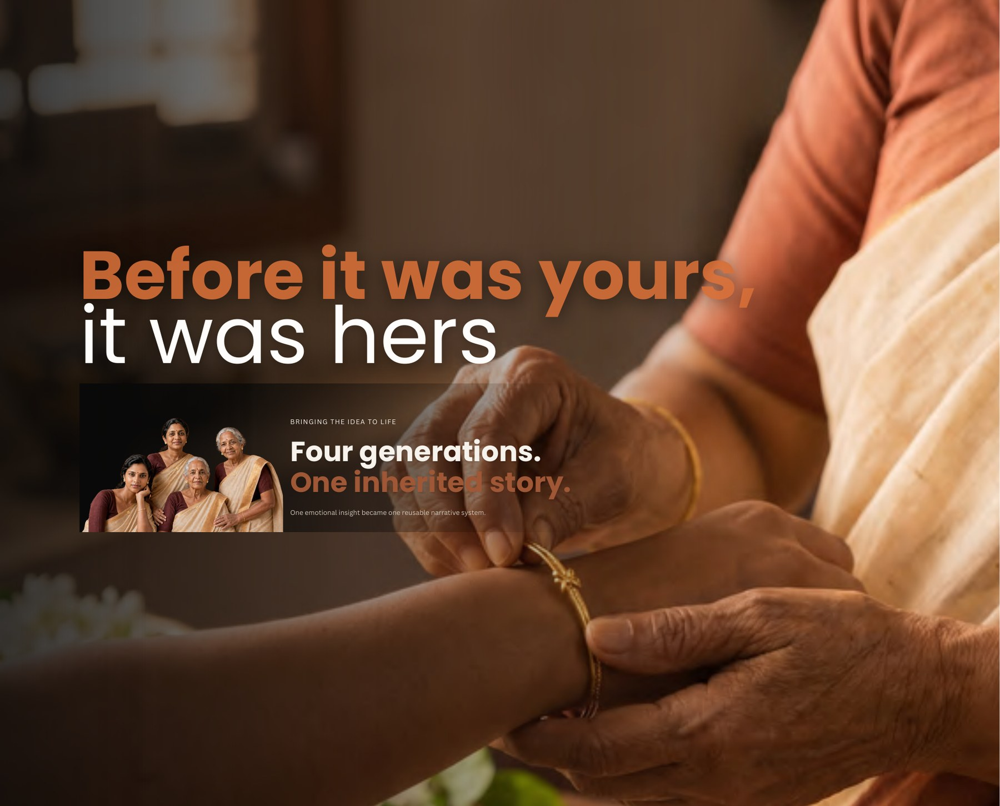
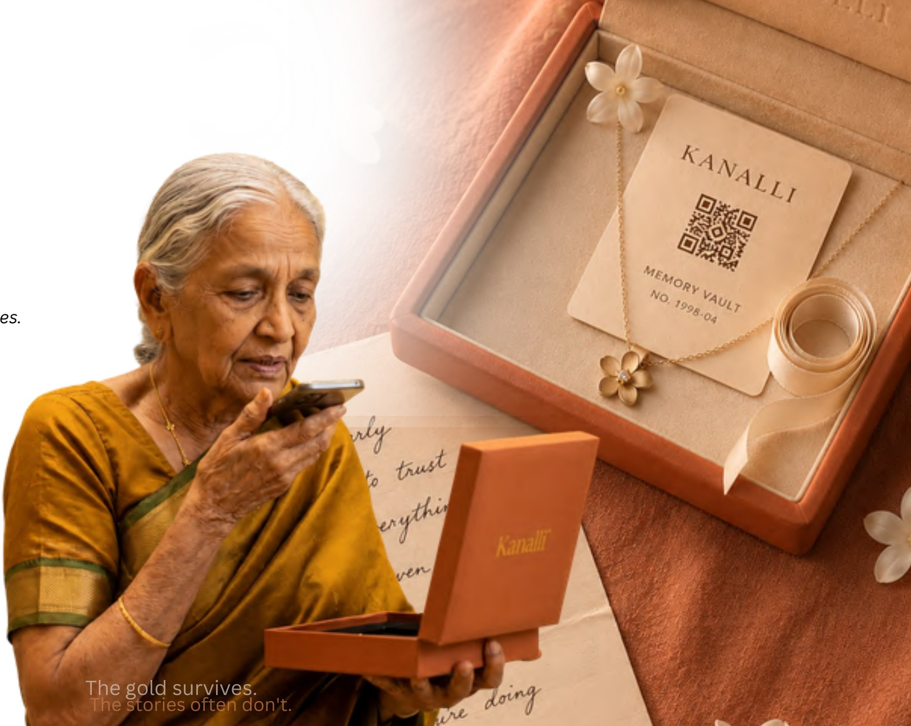
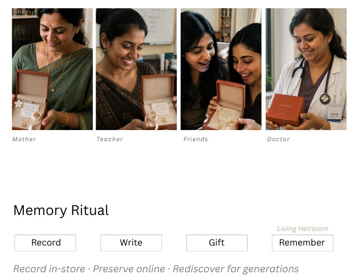
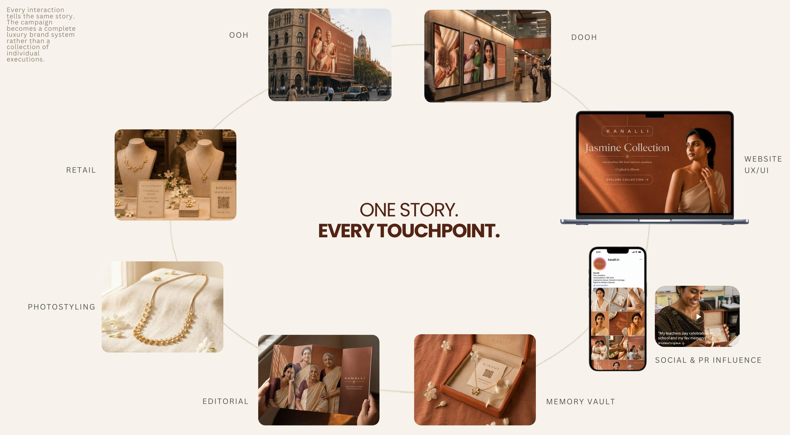
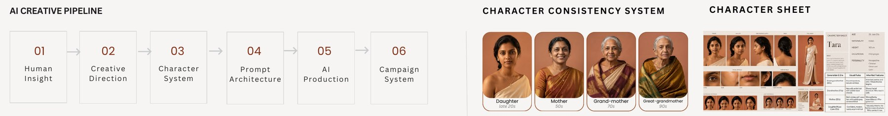
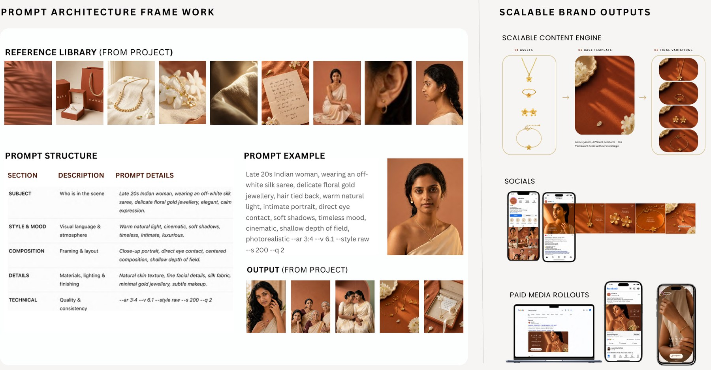

# KANALLI

## Before It Was Yours, It Was Hers.

**Four generations. One inherited story.**

**REAL CLIENT WORK · INDIA · 2026**

### The gold survives. The stories often don't.

> *The Living Heirloom* is the name of the proposed AI-powered brand experience developed within this project.

---

## Project Overview

Luxury brand experience design for Kanalli, a fine jewellery brand. The project turns one emotional insight into a complete, reusable narrative system, carried from a single idea through to a full campaign.

---

## Challenge

Help Kanalli differentiate beyond craftsmanship by transforming jewellery into an emotional brand experience.

---

## Big Idea

### Before it was yours, it was hers.

Transform inherited jewellery into living heirlooms that carry family stories across generations.

*Four generations. One inherited story.*

---

## The Living Heirloom

*Every Kanalli piece preserves a voice, a handwritten letter, and a lifetime of memories.*

A proposed AI-powered brand experience that transforms inherited jewellery into inherited memories. One emotional ritual, countless relationships.

### Memory Ritual

**Record → Write → Gift → Remember**

Record in-store · Preserve online · Rediscover for generations

The ritual is shown across different relationships: mother, teacher, friends and doctor.

---

## One Story. Every Touchpoint.

Every interaction tells the same story. The campaign becomes a complete luxury brand system rather than a collection of individual executions.

- **OOH & DOOH**
- **Retail**
- **Website UX/UI**
- **Social & PR influence**
- **Memory Vault**
- **Editorial**
- **Photostyling**

### UGC Campaign Sample — Gift Experience

> **Speculative concept.** Not commissioned or launched work.

A sample UGC-style video execution developed as part of the speculative Kanalli gifting campaign, bringing the emotional idea of inherited memories and meaningful gifting into a social-first format.

**[▶ Watch the UGC sample on YouTube](https://www.youtube.com/shorts/ygxLdKCZNME)**

---

## Behind the System

One emotional insight became a repeatable AI-powered luxury content system.

**Human Insight → Character System → Prompt Architecture → AI Production → Human QA → Campaign Rollout**

The AI creative pipeline runs in six steps: Human Insight, Creative Direction, Character System, Prompt Architecture, AI Production and Campaign System. A character consistency system carries four generations of one family through the campaign: daughter (late 20s), mother (50s), grandmother (70s) and great-grandmother (90s).

A prompt architecture framework, built on a reference library from the project, drives a scalable content engine: the same system applied to different products, with the framework holding without a redesign.

---

## My Role

- Creative Direction
- Brand Strategy
- Art Direction
- AI Visual Development
- Prompt Design

**Project scope** 
4 core characters · 80+ campaign assets · 40 deliverables · 6 weeks production

---

## Creative Toolkit

ChatGPT · Midjourney · Canva · Adobe Creative Cloud · Weavy · HeyGen · ComfyUI · Nano Banana · Veo 3 · CapCut · Figma · ElevenLabs · Higgsfield · Claude · Photoshop

---

Kanalli and the products shown are the property of their respective owners.

[← Back to Selected Creative Projects](README.md)
