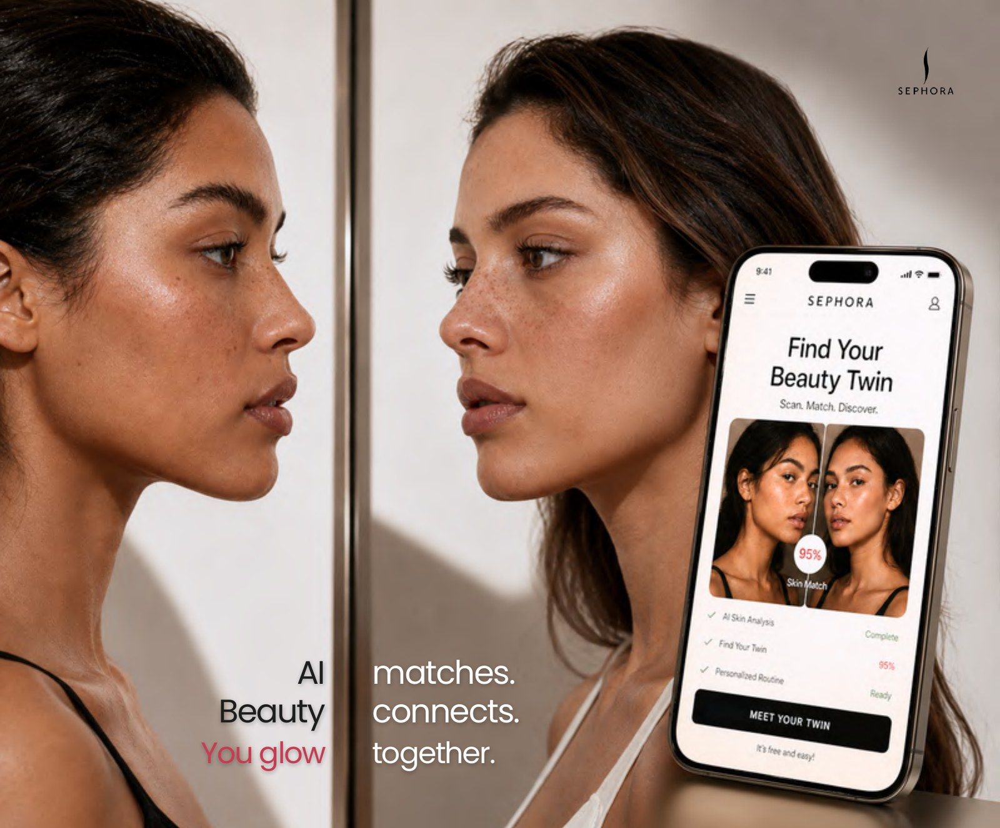
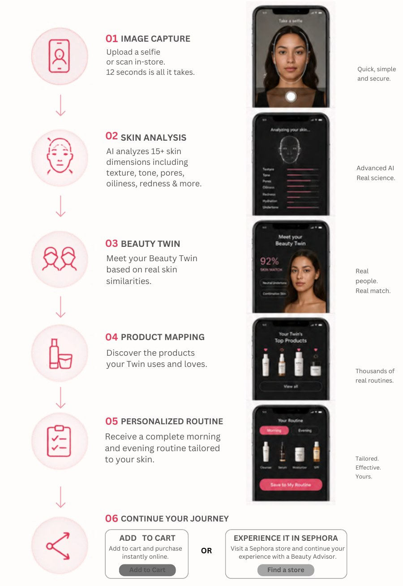
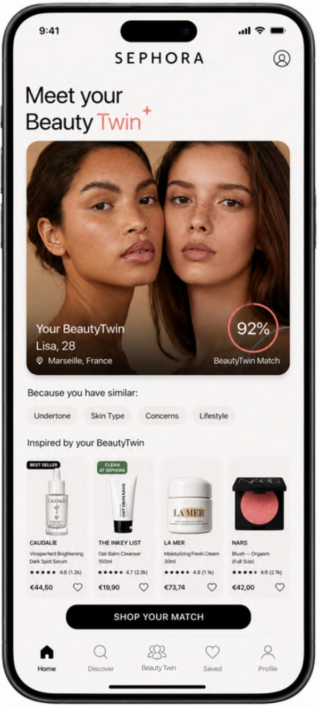
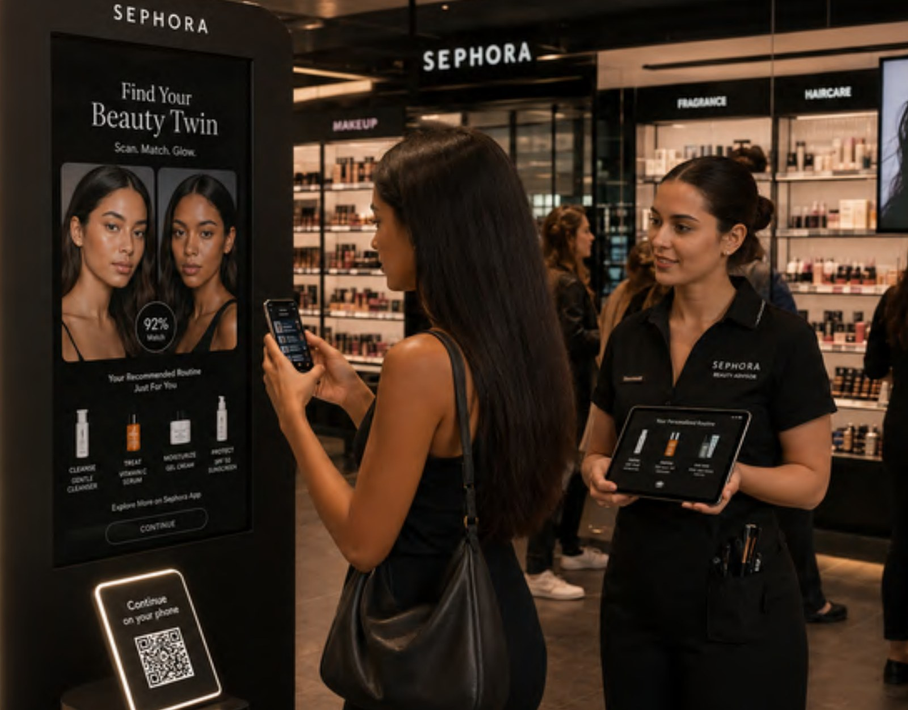
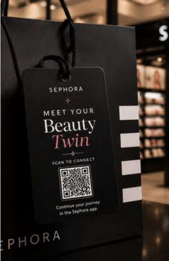
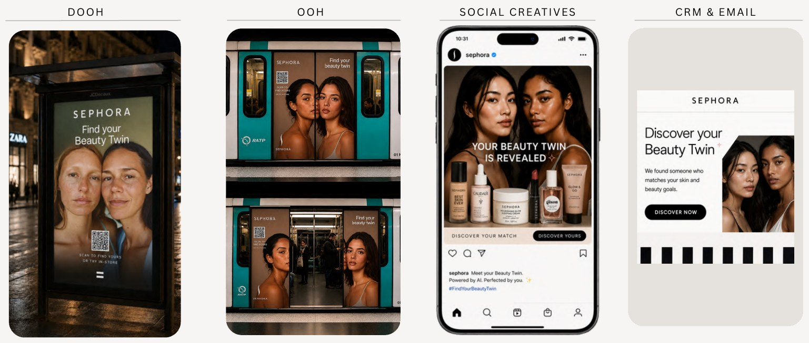

# SEPHORA — Find Your Beauty Twin

### AI-Powered Beauty Personalization

> **Concept work at Ogilvy AI Lab Paris.** This is a creative concept. It is not an officially commissioned or launched Sephora campaign.

---

## Project Overview

*Find Your Beauty Twin* is a concept for an AI-powered beauty personalization experience. It reimagines beauty discovery as person-led rather than product-led, and extends across the app, the store and social, as one connected campaign.

---

## AI Campaign Film

### Find Your Beauty Twin — AI Campaign Film

An AI-driven visual interpretation of the Find Your Beauty Twin concept, bringing the beauty personalization experience to life through motion.

  

  <a href="https://youtube.com/shorts/RNYyr_6_vSM"><b>▶ Watch the film on YouTube</b></a>

---

## Challenge & Insight

**Challenge** 
Beauty recommendations are still product-first, not people-first.

**Insight** 
People trust recommendations from someone who shares their skin reality.

---

## Big Idea

### Find Your Beauty Twin.

An AI experience that matches customers with their Beauty Twin and recommends products that actually worked for them.

*AI matches. Beauty connects. You glow together.*

The concept frames beauty discovery as a paradigm shift, from product-led to person-led:

| | |
|---|---|
| **The past** | Ruled by algorithms |
| **The present** | Enhanced by data |
| **The future** | Powered by connection |

It is powered by Sephora's community, skin data, purchase history and retail network.

---

## Digital Experience: The Six-Step Journey

| Step | Moment | What happens |
|---|---|---|
| **01** | Image capture | Upload a selfie or scan in-store. |
| **02** | Skin analysis | AI analyzes 15+ skin dimensions including texture, tone, pores, oiliness, redness and more. |
| **03** | Beauty Twin | Meet your Beauty Twin, based on real skin similarities. |
| **04** | Product mapping | Discover the products your Twin uses and loves. |
| **05** | Personalized routine | Receive a complete morning and evening routine tailored to your skin. |
| **06** | Continue your journey | Add to cart and purchase online, or continue the experience in a Sephora store with a Beauty Advisor. |

  

---

## Campaign Ecosystem

A connected campaign across digital, retail and social touchpoints.

- **Digital:** web and app journey, plus a campaign website
- **Retail:** in-store activation, with bag tags and promo cards
- **Influencer collaboration:** creator-led content
- **UGC:** user-generated content
- **OOH & DOOH:** out-of-home and digital out-of-home
- **Social creatives:** social-first campaign content
- **CRM & email:** personalised email content

### In-store

*Beauty, brought into store.* In-store experiences that turn discovery into connection: human, immersive and unmistakably Sephora.

  

### Across channels

---

## My Role

- AI Art Direction
- Creative Strategy
- Experience Design
- Campaign Development

**Deliverables** 
Web + app journey · In-store activation · OOH + DOOH · Social + UGC · Influencer + CRM content

---

## Creative Toolkit

Midjourney · ChatGPT · Canva · Higgsfield · Claude · HeyGen · Nano Banana · Kling AI · Veo 3 · Figma · CapCut · ElevenLabs · Photoshop

---

Concept work created for portfolio purposes. Sephora and the brands and products shown are the property of their respective owners; no affiliation or endorsement is implied.

[← Back to Selected Creative Projects](README.md)
