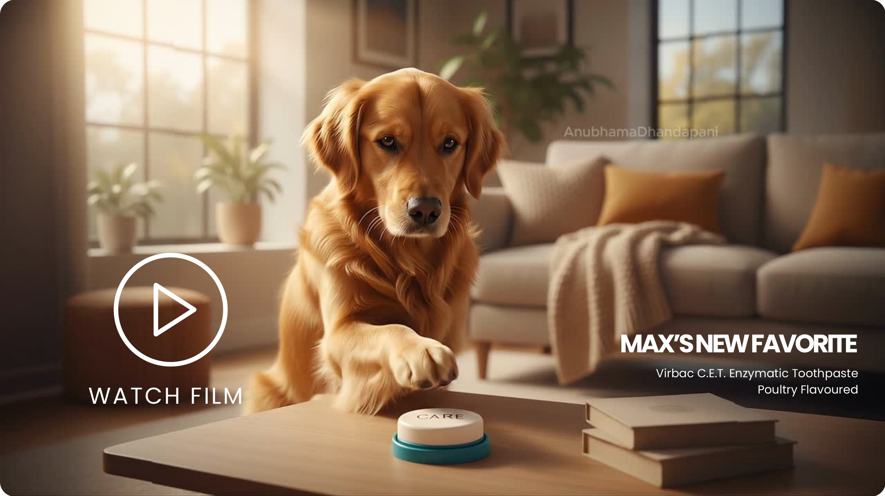
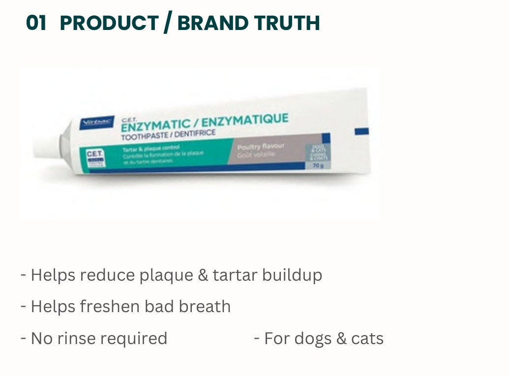
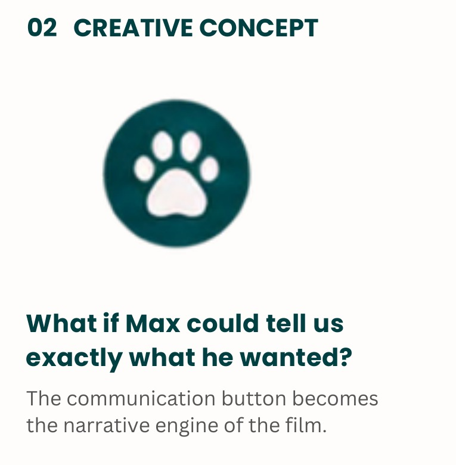
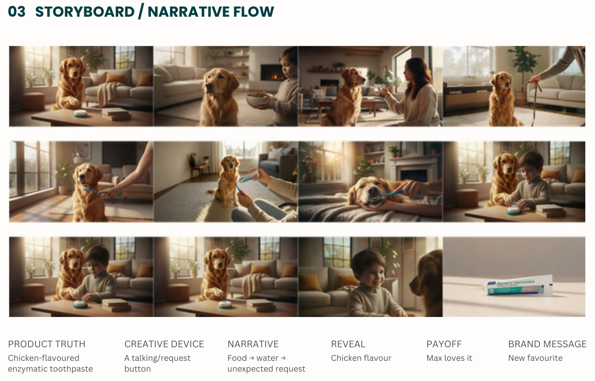
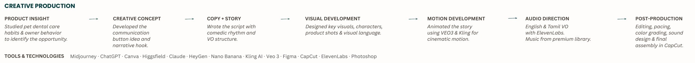
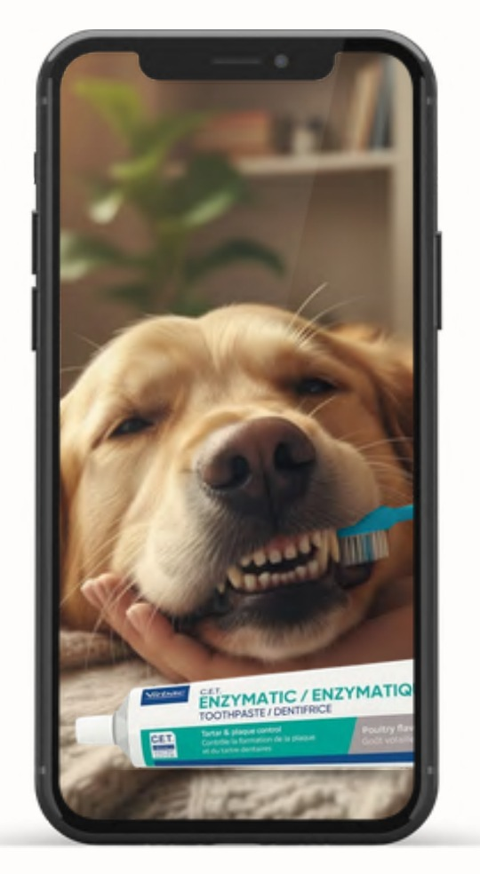

# VIRBAC C.E.T. — Max's New Favorite.

## A playful AI-powered product advertising film.

**SELF-INITIATED SPEC FILM · 2026**

> **Speculative concept.** Self-initiated work. Not commissioned, approved or launched by Virbac.

**[▶ Watch the film on YouTube](https://youtu.be/4uQpDx8xy0c)**

---

## Project Overview

A self-initiated spec film for Virbac C.E.T. Enzymatic Toothpaste (poultry flavoured). The film turns a product benefit into a moment of love and connection, built around one playful device: a request button that lets Max ask for what he wants.

---

## Product Insight

I studied pet dental care habits and owner behaviour to identify the opportunity.

**Product truth:** chicken-flavoured enzymatic toothpaste.

- Helps reduce plaque and tartar buildup
- Helps freshen bad breath
- No rinse required
- For dogs and cats

---

## The Creative Concept

### What if Max could tell us exactly what he wanted?

The communication button becomes the narrative engine of the film.

**Creative device:** a talking/request button.

---

## The Story

### Food → Water → Unexpected Request

The film follows a simple escalation: Max presses the button and his owners guess what he wants, until the request turns out to be something unexpected.

**Narrative:** Food → water → unexpected request 
**Reveal:** Chicken flavour 
**Payoff:** Max loves it 
**Brand message:** New favourite

**Script excerpt (English VO)**

> First, food. Nope. 
> Then, water. 
> Still no. 
> A walk? 
> Definitely not. 
> Oh, that was unexpected. 
> Turns out, it's chicken flavored.

---

## Hero Film

*A playful story that turns a product benefit into a moment of love and connection.*

**[▶ Watch "Max's New Favorite" on YouTube](https://youtu.be/4uQpDx8xy0c)**

A 30-second hero film (16:9) for Virbac C.E.T. Enzymatic Toothpaste, poultry flavoured. Self-initiated speculative work.

---

## Storyboard & Visual Development

I designed the key visuals, characters, product shots and visual language, then mapped the film beat by beat: product truth, creative device, narrative, reveal, payoff and brand message.

---

## AI Production Workflow

1. **Product insight:** studied pet dental care habits and owner behaviour to identify the opportunity.
2. **Creative concept:** developed the communication button idea and narrative hook.
3. **Copy + story:** wrote the script with comedic rhythm and VO structure.
4. **Visual development:** designed key visuals, characters, product shots and visual language.
5. **Motion development:** animated the story using Veo 3 and Kling for cinematic motion.
6. **Audio direction:** English and Tamil VO with ElevenLabs, with music from a premium library.
7. **Post-production:** editing, pacing, colour grading, sound design and final assembly in CapCut.
8. **Campaign assets:** a 30-second hero film (16:9), with the creative extendable into a 9:16 vertical adaptation for social and digital platforms.

---

## Deliverables

- **30-second hero film** · 16:9
- **9:16 vertical adaptation** · extendable for social and digital platforms

*The hero film is produced in 16:9. The creative can be extended and adapted into a 9:16 vertical format.*

---

## My Role & Creative Toolkit

**My Role**

Product Insight · Creative Concept · Copy & Story · Visual Development · Motion Development · Audio Direction · Post-Production · Campaign Assets

**Creative Toolkit**

Midjourney · ChatGPT · Canva · Higgsfield · Claude · HeyGen · Nano Banana · Kling AI · Veo 3 · Figma · CapCut · ElevenLabs · Photoshop

---

*Self-initiated speculative work, created for portfolio purposes. Not commissioned, approved or launched by Virbac. Virbac and C.E.T. and the products shown are the property of their respective owners.*

[← Back to Selected Creative Projects](README.md)
